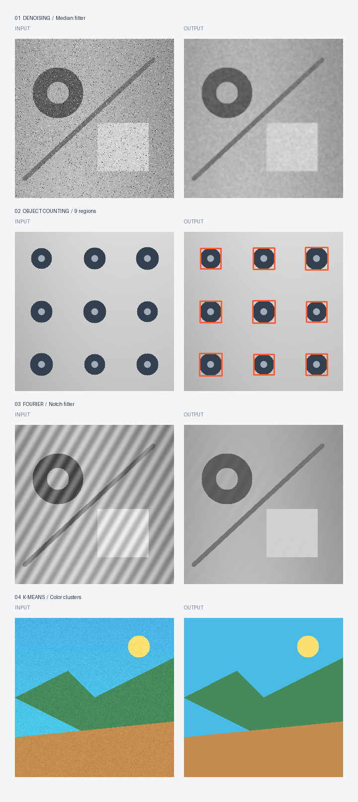

# 01 — Image Processing, from Theory to Pixels

An independent mini-project exploring **four classical computer-vision techniques** through a tiny interactive Python app. No model calls, no datasets to download, no university files.



## What it demonstrates

| Experiment | Technique | What to look for |
| --- | --- | --- |
| Denoising | Gaussian smoothing vs. median filtering | Different responses to impulse and Gaussian noise |
| Object counting | Illumination estimation + Otsu threshold + connected components | Count dark separated objects on a nonuniform background |
| Periodic-noise removal | FFT + conjugate-pair notch rejection + inverse FFT | Remove injected sinusoidal interference |
| Color clustering | K-means on RGB pixel vectors | Segment pixels by color, **not** by semantic class |

## Run locally (Windows PowerShell)

Use Python 3.10 or newer, preferably 3.11–3.13.

```powershell
cd "D:\DEV\Projects\00_ACTIVE\from-lab-to-code\01-image-processing"
py -m venv .venv
.\.venv\Scripts\python.exe -m pip install -r requirements.txt
.\.venv\Scripts\python.exe -m streamlit run app.py
```

Streamlit opens a local browser page. Each mode starts with an **original image generated in Python**. You can also upload an image for a quick test.

## Regenerate examples and run checks

```powershell
.\.venv\Scripts\python.exe demo.py
.\.venv\Scripts\python.exe -m unittest discover -s tests -v
```

## What I learned

- Spatial-domain filters trade detail preservation for noise suppression.
- Uneven lighting often makes thresholding harder; estimating a background helps.
- Periodic noise creates a conjugate pair of peaks in a real-valued image's Fourier spectrum.
- K-means groups pixel colors and should not be confused with semantic segmentation.

## Limitations

- The object counter assumes dark, separated objects against a lighter background.
- The FFT notch positions are **known** because the demo creates interference with specified frequencies; automatic peak detection for real photographs is not implemented.
- Denoising can remove fine details; the best filter depends on the noise.
- Color clustering ignores spatial relationships between pixels.

## Originality and assets

All Python code and included sample images were independently created for this repository. The images in `results/` are produced by `synthetic.py` and `demo.py`. This project does **not** redistribute university course PDFs, notebooks, code, instructions, lab images, datasets, or logos. Third-party Python packages remain under their own licenses. Please only upload images you are authorized to use.

Code license: MIT (see repository root).
