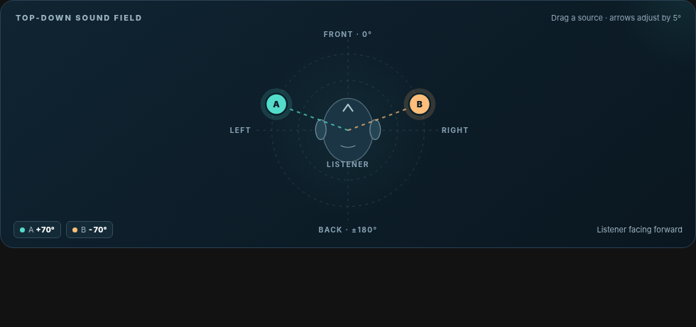
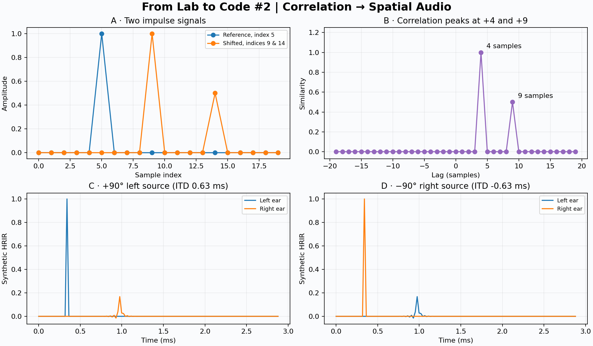

# 02 — Spatial Audio Playground

**Hear where sound lives.** This mini-project makes sound localization tangible: place one or two virtual mono sound sources around a listener, then listen to the centered mono and binaural stereo versions. Explore interaural time and level differences and connect those cues to a hands-on cross-correlation example.

Part of [From Lab to Code](https://github.com/Ertugrulmutlu/from-lab-to-code). Every project is independently runnable and self-contained. This entry uses **original generated sounds** and **independently written code**. It does not ship university assignments, course notebooks, commercial audio, private datasets, or measured HRIR files.





## Try it in 2 minutes

You need Python **3.11–3.13**, a browser, and headphones. Open **PowerShell** in the `02-spatial-audio` directory:

```powershell
py -m venv .venv
.\.venv\Scripts\python.exe -m pip install -r requirements.txt
.\.venv\Scripts\python.exe -m streamlit run app.py
```

Then open `http://localhost:8501` if it does not open automatically.

You do **not** need Node.js, an account, external audio assets, a model/API key, or university data. The browser stage is a bundled self-contained HTML/JS component.

**First things to try:**

1. Play **Centered mono**, then **Binaural stereo** with headphones. The input source gains are identical between versions.
2. Drag the teal **A** marker to +90° (left) or −90° (right). Drag the amber **B** marker independently. The clips are re-rendered when you release the pointer.
3. Use **Left / Front / Right / Back** presets for the selected sound source. Sliders also work without the draggable component.
4. Change the sound on either source to **My WAV upload**. Your file must be ≤12 seconds and ≤12 MiB; mono and stereo WAVs are downmixed/resampled to 44.1 kHz. Avoid sensitive recordings on hosted instances.
5. Examine the **ITD** and **ILD** values for either source and compare the left/right HRIR waveforms.
6. Switch to **Correlation lab**. Impulses at indices `5`, `9`, `14` create two peaks at lags **+4** and **+9**; vary the sample positions and amplitude.

### User journey

```text
Launch app → Sound stage → Drag A/B or use presets → Adjust gain/elevation
         → Choose built-in samples or upload WAVs → Listen to mono/binaural
         → Inspect source A/B timing and energy cues
         ↘ Correlation lab → Understand the foundations
```

## What changed versus the first prototype

- **Sound stage is the first screen**, rather than requiring users to begin with equations.
- A **responsive, draggable 2D stage** is implemented as a small local Streamlit component (`frontend/index.html`), supporting mouse, touch and keyboard arrows. It synchronizes source positions with Python once a drag ends, not 60 times per second.
- Both sources can load their **own WAV files**, select a built-in sample, and adjust azimuth, elevation, and gain.
- Mono and binaural audio use **one common safety-gain factor**: they are never normalized independently. This keeps source input levels and spatial cues comparable. It does **not** imply equal perceived loudness across all playback systems.
- **ITD/ILD and HRIR plots can inspect either source**, not only the first source.
- Native Streamlit inputs and Plotly charts make the controls accessible and responsive; a dark theme and custom typography supply an identifiable visual identity.
- Tests explicitly exercise two-source scenes, shared-gain behavior, left/right direction signs, and WAV encoding.

## Files

```text
02-spatial-audio/
├── app.py                 # Streamlit screens, presets, listening workflow, plots
├── frontend/index.html    # Fully local drag-to-position SVG + JS component
├── audio_pipeline.py      # Single scene rendering + common mix normalization
├── binaural.py            # Stereo convolution, WAV/SOFA import, WAV export
├── correlation.py         # Cross-correlation, sample lags, ITD / ILD
├── synthetic.py           # Deterministic original demo sounds, toy HRIRs
├── demo.py                # Generate shareable results
├── requirements.txt
├── .streamlit/config.toml # Dark theme and local upload limit
├── tests/
│   ├── test_binaural.py
│   ├── test_correlation.py
│   └── test_pipeline.py
└── results/
    ├── overview.png
    ├── stage-preview.png
    ├── preview_mono.wav
    └── preview_stereo.wav
```

## Test and regenerate

```powershell
.\.venv\Scripts\python.exe -m unittest discover -s tests -v
.\.venv\Scripts\python.exe demo.py
```

The first release of this update runs **18 automatic unit/integration tests**. These verify the signal-processing pipeline, not every browser or Streamlit version. Please run the local UI before committing.

## Signal-processing design

### Cross-correlation

SciPy computes `signal.correlate(shifted, reference, mode="full")` and its sample lags. The **order matters**; a delayed shifted signal produces a positive lag. Nonzero impulse correlations are labeled in the chart.

### Binaural convolution

For each source audio `x[n]`, we compute `y_L = x * h_L` and `y_R = x * h_R`, using `scipy.signal.oaconvolve`, then sum the rendered sources. The reference **mono** sum uses the same input source gains, with one shared scale factor applied to both the mono and binaural results only when needed to avoid clipping.

### ITD and ILD

- Coordinate convention: **0° front, +90° left, −90° right, ±180° behind**.
- ITD is **right minus left** arrival time. Positive means the right ear is delayed. Estimated by cross-correlating 1.5 kHz low-pass filtered HRIR channels, limited to ±1 ms.
- ILD is the broadband energy ratio `10·log10(sum(h_R²)/sum(h_L²))`. Negative means the right ear has less energy.
- These are summary cues; do not confuse them with perceptually calibrated measurements across every frequency.

### Optional SOFA

The advanced panel accepts a **user-supplied, compatible and licensed** SOFA file (maximum 45 MiB), using `Data.IR` shape `(M, 2, N)` and spherical source positions in degrees. Receiver 0 is assumed left and 1 right. It uses the nearest measured direction, with no direction interpolation; datasets with other coordinate systems/channels are not supported.

### Limitations to know

The default **synthetic HRIRs are educational approximations** with timing, attenuation and mild spectral coloring. They are not personalized measurements, so reliable elevation and front/back effects should not be expected. Even with a measured HRTF, realistic 3D localization depends on your anatomy, headphones and calibration.

The app creates **static offline clips**. Dragging source positions updates the next rendering; it is **not** streaming real-time audio, doppler simulation, moving-source interpolation or head tracking. If hosted remotely, uploads transit the hosting service, although the app code processes files in memory and does not save them to disk.

## References

- [SciPy correlate](https://docs.scipy.org/doc/scipy/reference/generated/scipy.signal.correlate.html)
- [SciPy correlation_lags](https://docs.scipy.org/doc/scipy/reference/generated/scipy.signal.correlation_lags.html)
- [SciPy oaconvolve](https://docs.scipy.org/doc/scipy/reference/generated/scipy.signal.oaconvolve.html)
- [SOFA / AES69 overview](https://www.sofaconventions.org/)
- [Streamlit custom components](https://docs.streamlit.io/develop/concepts/custom-components/components-v1/intro)

All original code and generated demo assets are MIT-licensed under the parent repository. Third-party dependencies retain their own licenses.
