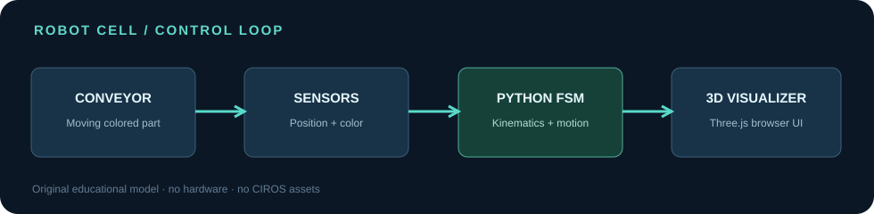

# 03 — Robot Cell Playground

**Pick. Detect. Wire. Sort.** A small, independently implemented robotics simulation built around a Python state machine, editable digital I/O connections and a lightweight 3D browser interface.

Part of the [From Lab to Code](https://github.com/Ertugrulmutlu/from-lab-to-code) series. Inspired by general robot-cell concepts explored during a university laboratory, but **all code and visualizations here are original**. No CIROS assets, course handouts, model files or university-owned images are redistributed.



## Quick start (Windows PowerShell)

From the `03-robot-cell` directory:

```powershell
py -3 -m venv .venv
.\.venv\Scripts\python.exe -m pip install -r requirements.txt
.\.venv\Scripts\python.exe -m unittest discover -s tests -v
.\.venv\Scripts\python.exe app.py
```

Open **http://127.0.0.1:5000**. Press **START CELL** to sort red, green and blue boxes; adjust speed, pick a fixed color, orbit the scene and view live sensor/robot status. Scroll to **Wiring Lab** to edit the connections. Press **Ctrl+C** in PowerShell to stop the server.

Requires Python 3.10+ with Flask. **The browser needs an internet connection on first load** for the pinned Three.js ES modules served by jsDelivr; no Node/npm build step is required. The Python simulation logic itself is offline-capable.

## Features

- A 3-degree-of-freedom geometrical robotic arm: base yaw, shoulder and elbow joint angles.
- Analytical forward and inverse kinematics using a two-link planar mechanism with base rotation.
- Automated conveyor → idealized position detection → color identification → pick → lift → transfer → place → reset.
- User controls for start, pause, reset, simulated speed and next item color.
- **Interactive I/O Wiring Lab:** ten output ports and ten input ports with click-to-connect wiring, live HIGH/LOW level indicators, editable routing and built-in fault scenarios.
- **Actual behavior depends on the wiring.** Disconnecting the conveyor output stalls the conveyor; disconnecting the position sensor prevents pickup; an unplugged gripper or sink produces a fault; swapped color inputs cause a visible mis-sort and increment the mis-sort counter.
- Event stream, successful-sort / mis-sort counters and Python unit tests for kinematics, I/O and complete sorting cycles.
- Flask JSON interface: `GET /api/state`, `POST /api/control`, `POST /api/step`, `POST /api/wiring`.

## Project layout

```text
03-robot-cell/
├── app.py                     # Flask API and local server
├── robotics/
│   ├── kinematics.py          # Forward + inverse kinematics
│   ├── sensors.py             # Idealized position + color sensors
│   ├── io.py                  # Digital ports, routing and Boolean signals
│   └── simulation.py          # FSM, wired control and motion logic
├── templates/index.html       # Local UI
├── static/css/style.css
├── static/js/main.js          # UI controls and API polling
├── static/js/scene.js         # Three.js visualization
├── demo.py                    # Reproducible 12-item simulation result
├── results/                   # Original architecture graphic + JSON result
├── tests/                     # Kinematics, I/O, fault and API tests
├── tools/update_showcase.py   # Optional existing-website update
└── requirements.txt
```

## Try the I/O Wiring Lab

Below the 3D cell, you can edit the logical wiring while **paused**:

1. On the left, click an **OUTPUT** (for example `Robot.StartStop`). Then click the destination **INPUT** (`Belt.OnOff`) on the right. Only output → input connections are valid.
2. With no selected output, click a connected input to **unplug** it. Each input accepts one source output; one output can fan out to multiple inputs.
3. Choose a preset under **TRY A FAULT SCENARIO** and press **APPLY**, or press **DEFAULT WIRING** to restore all ten recommended connections.
4. Press **START CELL** and watch the robot's actual behavior and the live HIGH/LOW lamps. **Editing wiring resets the current simulation and statistics**. Normal Reset preserves the current wiring; Default Wiring restores the original routes.

| Experiment | Expected observation |
| --- | --- |
| Unplug conveyor | `Robot.StartStop` HIGH, but `Belt.OnOff` LOW; box stays at source |
| Unplug position sensor | Conveyor reaches pickup, but robot never receives `ItemAvailable` |
| Unplug gripper | Robot reaches the pickup but triggers a vacuum-gripper fault |
| Swap red/blue sensor lines | A red box gets identified as blue, goes to the blue bin and is counted as mis-sorted |
| Restore default wiring | All three colors are sorted into their matching bins |

A port's LED indicates the **Boolean signal level**, not the presence of a wire; unplugged inputs are marked separately. This models digital logic only (no analog values, electrical characteristics, or actual robot controller/PLC hardware).

**Programmatic example (optional):** with Flask running locally, in PowerShell:

```powershell
$body = @{ action = 'disconnect'; input = 'Belt.OnOff' } | ConvertTo-Json
Invoke-RestMethod -Method Post -Uri http://127.0.0.1:5000/api/wiring -ContentType 'application/json' -Body $body
```

The backend rejects invalid port IDs/directions and forbids edits while the simulation is running. Pause first.

## Reproduce a deterministic run

```powershell
.\.venv\Scripts\python.exe demo.py
```

This generates `results/demo_summary.json` for 12 sorted items under fixed random seed 13. Counters are simulated outcomes, not measured hardware performance.

## Technical details

Let `r = √((x−bx)²+(y−by)²)` be the planar distance from the robot base and `h = z−shoulder_height` be the wrist elevation relative to the shoulder. For upper-arm length `L1` and forearm length `L2`:

```text
cos(q_elbow) = (r² + h² − L1² − L2²) / (2 L1 L2)
q_elbow = −acos(cos(q_elbow))
q_shoulder = atan2(h, r) − atan2(L2 sin(q_elbow), L1 + L2 cos(q_elbow))
q_base = atan2(y−by, x−bx)
```

The renderer receives the calculated joint positions from Python; it does **not** generate trajectories independently. A simple cubic smoothstep function interpolates joint angles through named controller states. The idealized color sensor produces three discrete outputs. The robot controller reads their levels **through the current user-defined routes** and uses those inputs to select a destination. The gripper and sink actions also require the corresponding wired inputs. A sink removes a part from the model; the visual bins retain up to five sample cubes, including the actual colors of incorrectly sorted parts.

## Limitations

This is a **teaching simulation**, not a physics-accurate or hardware-ready industrial robot controller. It does **not** model actuator dynamics, collisions, detailed gripper contact physics, visual camera recognition, obstacle avoidance, singularity handling, or calibration. The sensors and wiring are idealized digital logic. The application is designed as a **single-user local** Flask server, and the simulation progresses while a browser sends ticks; do not deploy the Flask development server publicly. The geometry and trajectories are simplified rather than reproducing any particular commercial robot model.

## Website publication

Once tests and the local UI have been checked, run this from the project folder:

```powershell
.\.venv\Scripts\python.exe tools\update_showcase.py
```

It updates the existing `docs/app.js` Project #03 placeholder to a published project card, and adds #03 to the root README table. The card points to the GitHub source code, **not a fake hosted Python playground**. The article link stays disabled until the corresponding technical article is published.

You can then commit `03-robot-cell/`, `docs/app.js` and `README.md` on a feature branch, open a PR, and merge when reviewed. GitHub Pages will rebuild the static showcase; the interactive Flask app remains locally runnable.

## License

Original project code is released under the repository's MIT license. Third-party dependencies retain their own licenses. Three.js is licensed under MIT. No university instructional documents or proprietary robot software are included.
