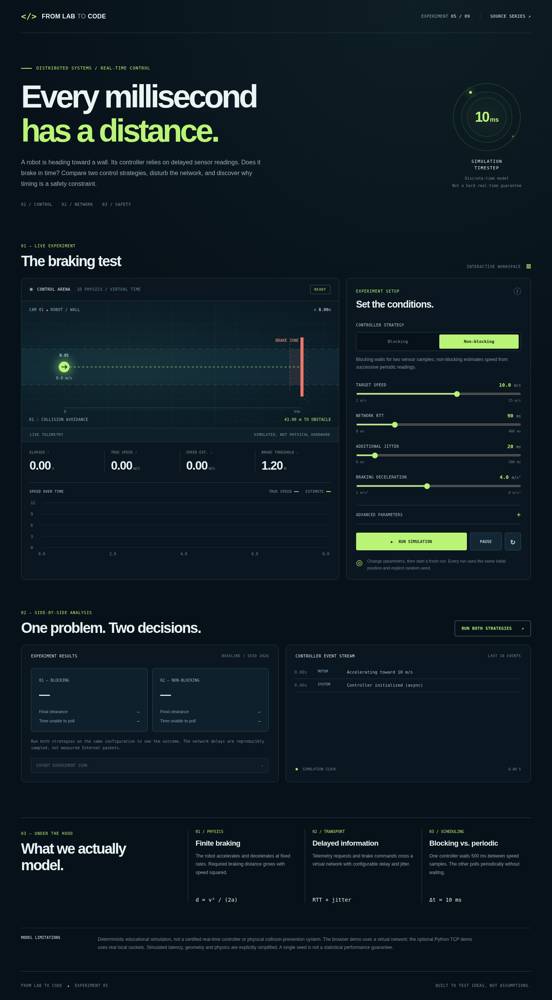
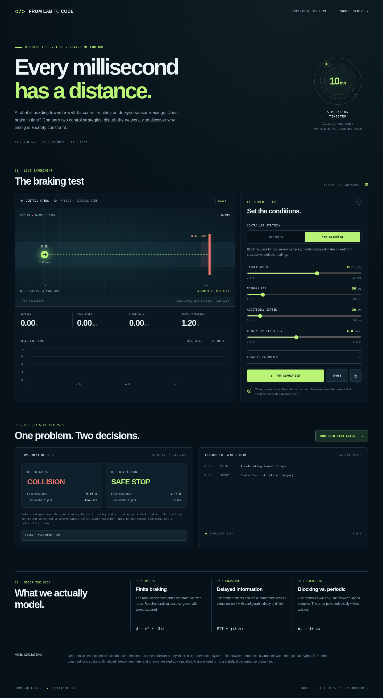
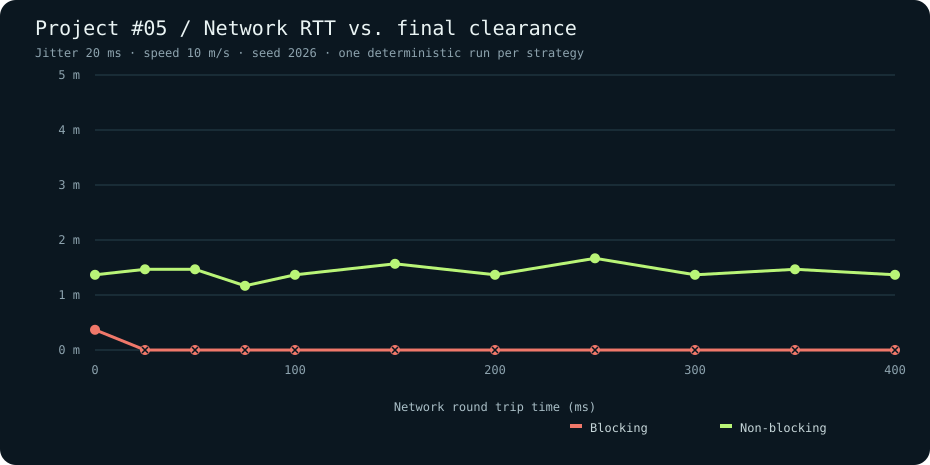

# 05 — Real-Time Robot Control Lab

**Every millisecond has a distance.** A small, original engineering experiment showing how network delay, blocking speed measurements, and braking physics interact in a wall-avoidance controller.

Part of the [From Lab to Code](https://github.com/Ertugrulmutlu/from-lab-to-code) series. This is an **independent educational implementation** inspired by general distributed-systems and real-time-control concepts. It does not reuse or redistribute university lab source code, handouts, proprietary simulation assets, or course branding.



## What you can do

- Drive an animated **one-dimensional robot** toward a wall using a deterministic virtual-time physics model.
- Switch between **blocking** two-sample speed measurement and **non-blocking** periodic telemetry.
- Adjust target velocity, network round-trip time, additional jitter, braking acceleration, controller polling interval, and safety margin.
- Observe the real speed, estimated speed, stopping threshold, simulated event log, and **safe-stop/collision** outcome.
- **Run both strategies** with identical settings and a fixed random seed; export a JSON result.
- Generate a latency-sweep comparison without a web browser or third-party numerical packages.
- Optionally run a **real local TCP** JSON-lines server and client as a separate transport demonstration.

## Quick start

Requires **Python 3.10+**. Run these commands inside `05-realtime-robot-control`.

### Windows PowerShell

```powershell
py -3 -m venv .venv
.\.venv\Scripts\python.exe -m pip install -r requirements.txt
.\.venv\Scripts\python.exe -m unittest discover -s tests -v
.\.venv\Scripts\python.exe app.py
```

### Linux / macOS

```bash
python3 -m venv .venv
source .venv/bin/activate
python -m pip install -r requirements.txt
python -m unittest discover -s tests -v
python app.py
```

Open **http://127.0.0.1:8000**. Choose a controller, press **RUN SIMULATION**, or click **RUN BOTH STRATEGIES** to compute a direct comparison. **PAUSE** freezes virtual time; **RESET** resets the current run. Stop the server with `Ctrl+C`.

The browser UI runs locally. No cloud API, database, account, or university server is needed.

## An example comparison

Settings: target speed **10 m/s**, simulated base network RTT **50 ms**, additional one-way jitter **up to 10 ms** per network leg (configured `jitter_ms = 20`), acceleration **3 m/s²**, deceleration **4 m/s²**, polling period **50 ms**, blocking measurement wait **500 ms**, safety margin **1.2 m**, and seed **2026**.

| Strategy | Simulated outcome | Final wall clearance | Time in blocking measurement phases |
| --- | --- | ---: | ---: |
| Blocking | **Collision** | 0.00 m | 4540 ms |
| Non-blocking | **Safe stop** | 1.47 m | 0 ms |

These results are **simulation outputs for one explicitly chosen scenario**, not measurements from a physical robot or claims about controller safety in general. Changing parameters can change which controller succeeds. The blocked-time metric counts virtual 10 ms ticks during the blocking measurement cycle; it is **not a formal deadline-miss analysis**.



## The model, precisely

The plant is **1D**: a circular robot (radius `1 m`, initial center position `x = 8 m`) travels toward a fixed wall at `x = 52 m`. Initial available clearance is **43 m**. Speed changes under constant bounded acceleration and deceleration, using a fixed 10 ms numerical step. The simulation does not model turning, friction, collisions with other robots, actuator lag, or stochastic sensor noise. On collision, the robot's center is clamped to the wall contact point.

For speed \(v\), braking deceleration \(a_b\), and a simplified reaction budget \(T\), the controller uses:

\[
 d_{brake}=\frac{v^2}{2a_b}, \qquad
 d_{critical}=d_{brake}+vT+d_{margin}
\]

In this demonstration, \(T = (RTT_{config} + jitter_{config} + poll_{config}) / 1000\). This is a **heuristic design budget**, not a guaranteed upper bound on actual end-to-end latency or reaction time.

- **Virtual transport:** each request and response leg is delayed by half of the configured baseline RTT plus a uniformly sampled nonnegative delay between `0` and `jitter_ms / 2`. Separate draws are used for each leg. Values are quantized upward to 10 ms virtual ticks; therefore the measured simulated RTT can exceed the nominal configured RTT.
- **Non-blocking controller:** requests telemetry periodically (`poll_ms`, default 50 ms). When a fresh pair of samples arrives, it computes odometer difference divided by sample-time difference, checks the critical distance, and can issue a brake command without waiting for a sleep interval.
- **Blocking controller:** requests a first sample, waits `measurement_ms` (default 500 ms), requests a second sample, estimates speed, then makes the same braking decision. It does not issue a new telemetry request while in that measurement cycle. The controller intentionally does **not** add its full measurement wait to the braking formula: that omission illustrates the risk of ignoring blocking time.
- **Brake command:** travels through a simulated one-way network delay before the plant receives it. The plant then decelerates gradually; requesting a brake does not cause an instantaneous stop.
- **Determinism:** for identical seed, strategy, and settings, the virtual event engine produces identical results. The two strategies draw different packet sequences, so *same seed* does not mean identical per-packet delays.

The title refers to real-time design principles, **not to a hard real-time guarantee**. Python, FastAPI, web browsers, and local sockets do not provide certified real-time scheduling.

## Repeat the experiments

From this project's root:

```bash
python -m experiments.latency_sweep
```

This regenerates `results/latency_sweep.json` and `results/latency_sweep.svg` for configured baseline RTT values from **0 through 400 ms**, using one deterministic run per controller and RTT. The graph is a scenario comparison, not a statistical estimate of failure probability.



### Optional: real loopback TCP demonstration

The browser simulation uses an intentionally simulated transport. To see a genuinely networked interaction, start **two** local terminals in the project folder:

```bash
python -m robot_lab.tcp_demo server --port 30352
```

```bash
python -m robot_lab.tcp_demo client --port 30352 --speed 10
```

This is a separate localhost **JSON-lines-over-TCP demonstration** with an independently implemented protocol; it does **not** connect to the university robot arena or implement its protocol. Actual host scheduling and loopback timing affect the result. Avoid comparing these timing measurements directly to the virtual-time graphs. The default server binds only to `127.0.0.1`.

## Project layout

```text
05-realtime-robot-control/
├── app.py                         # Local FastAPI server and experiment endpoints
├── robot_lab/
│   ├── physics.py                 # 1D robot, kinematics, braking and wall
│   ├── simulation.py              # Discrete-event simulated network + controllers
│   └── tcp_demo.py                # Optional real local TCP connection
├── templates/index.html           # Interactive dashboard layout
├── static/app.js                  # Canvas visualization, sliders, chart and events
├── static/style.css               # Responsive visual design
├── experiments/latency_sweep.py   # Reproducible comparison and SVG generation
├── results/                       # Result files and captured dashboard previews
├── tests/                         # Automated model, API and actual TCP tests
├── tools/update_showcase.py       # Optional integration with the existing project site
├── requirements.txt
└── README.md
```

### API

| Endpoint | Purpose |
| --- | --- |
| `GET /api/health` | Status and simulation identity |
| `GET /api/state` | Current virtual-time snapshot |
| `POST /api/start` | Start a run with `{"mode":"async","settings":{"network_rtt_ms":50}}` |
| `POST /api/advance` | Advance `{"steps":8}` simulation ticks |
| `POST /api/compare` | Deterministically run both controllers to completion |

Only a single shared, local simulation instance is intended. Do **not** deploy the dev server as a production or multi-user service.

## Publishing to the main series (optional)

The standalone project can be reviewed first without altering the public site. After copying the folder to the root of the main `from-lab-to-code` repository, run:

```bash
python 05-realtime-robot-control/tools/update_showcase.py --dry-run
python 05-realtime-robot-control/tools/update_showcase.py
```

The script makes Project #05 a **published project card** in `docs/app.js` and adds a line to the root README project table. It keeps Project #04 featured and intentionally leaves Project #05's article URL **empty** until an article actually exists. No push, commit, or DEV.to publication happens automatically. Review the diff before committing.

## Test and scientific limitations

- The automated tests check physics, deterministic replay, controller behavior, validation, local HTTP endpoints, and a real localhost TCP exchange. Tests do not establish physical safety or hard real-time schedulability.
- Telemetry observes exact simulated position and odometer (no measurement noise); asynchronous behavior comes from transport timing, not asynchronous threads in the virtual engine.
- Event times and dynamics are quantized to **10 ms**. The model is intentionally simple enough to inspect.
- A **single seed** is not a reliability metric. To study robustness, aggregate many seeds and vary both controller design and network distributions.
- This experiment illustrates what happens when blocking latency is *not included in the control reaction budget*; it does not prove that all blocking controllers are inherently unsafe.

Original source and original dashboard assets are intended for the repository's [MIT license](../LICENSE). Third-party Python dependencies retain their respective licenses.
